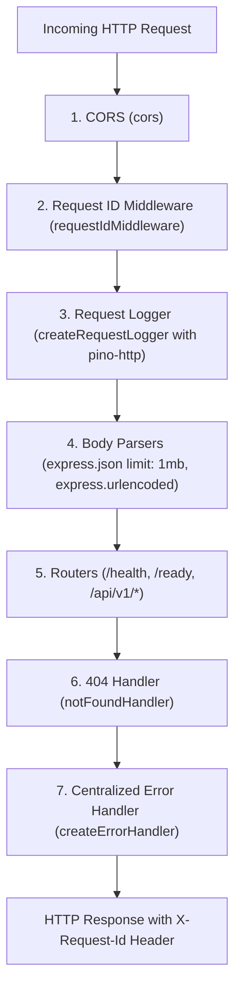

# GradeSTAR — API Foundation Architecture & Specifications (Phase 3A)

## 1. Overview

The GradeSTAR API (`apps/api`) provides the HTTP interface for web clients, external consumers, and operational telemetry.
Phase 3A establishes the core API foundation:

- Application factory decoupling (`createApp`) vs server lifecycle network binding (`server.ts`).
- Route versioning under `/api/v1` alongside root-level system checks (`/health`, `/ready`).
- Centralized environment configuration via Zod with production safety checks.
- Correlation Request ID middleware (`X-Request-Id`) with bounded format validation (`/^[a-zA-Z0-9_-]{1,64}$/`).
- Structured HTTP request logging with automated header and sensitive query redaction.
- Reusable runtime request validation for `params`, `query`, and `body` using Zod schemas.
- Centralized application error handling and typed `AppError` taxonomy.
- Graceful shutdown handling (`SIGINT`, `SIGTERM`, bounded 10s timeout, resource cleanup).

---

## 2. Express Middleware Pipeline

The middleware sequence in `createApp()` is strictly ordered to guarantee security, correlation, and error containment:



---

## 3. Endpoints Specification

| Method | Endpoint         | Description                            | Dependencies Checked           | HTTP Status Codes                   |
| :----- | :--------------- | :------------------------------------- | :----------------------------- | :---------------------------------- |
| `GET`  | `/health`        | Unversioned process liveness probe     | None (Node.js event loop only) | `200 OK`                            |
| `GET`  | `/ready`         | Unversioned dependency readiness probe | PostgreSQL query check         | `200 OK`, `503 Service Unavailable` |
| `GET`  | `/api/v1/health` | Versioned API liveness probe           | None (Node.js event loop only) | `200 OK`                            |
| `GET`  | `/api/v1/ready`  | Versioned API readiness probe          | PostgreSQL query check         | `200 OK`, `503 Service Unavailable` |

### Liveness Probe (`/health` and `/api/v1/health`)

Returns `200 OK` if the Node.js API process is responsive. It does not depend on database or cache availability.

```json
{
  "status": "ok",
  "timestamp": "2026-11-15T18:00:00.000Z",
  "uptimeSeconds": 42,
  "service": "gradestar-api",
  "environment": "development"
}
```

### Readiness Probe (`/ready` and `/api/v1/ready`)

Checks backing infrastructure dependencies required for API operations.

- **PostgreSQL**: Checked via lightweight `checkDatabaseHealth()` (`SELECT 1`) bounded by a 3000ms timeout.
- **Redis**: Marked as `not_implemented` until queue dispatch is integrated in Phase 4.
- Returns `503 Service Unavailable` if PostgreSQL fails or times out.
- **Security Rule**: Error details never leak connection strings, database passwords, or raw Prisma exceptions to the client.

```json
{
  "status": "ready",
  "timestamp": "2026-11-15T18:00:00.000Z",
  "service": "gradestar-api",
  "checks": {
    "process": {
      "status": "ok",
      "message": "API process is initialized and ready to accept HTTP traffic"
    },
    "postgres": {
      "status": "ok",
      "latencyMs": 4
    },
    "redis": {
      "status": "not_implemented",
      "message": "Redis queue connection is planned for Phase 4"
    }
  }
}
```

---

## 4. Request Correlation & Logging Policy

### Request ID Policy

1. When a client supplies `X-Request-Id` or `X-Correlation-Id`, the middleware checks if it matches `/^[a-zA-Z0-9_-]{1,64}$/`.
2. If valid, the client-supplied ID is preserved.
3. If missing or invalid (special characters, spaces, excessive length), a new UUIDv4 is generated via `crypto.randomUUID()`.
4. The resolved ID is attached to `req.id`, `req.requestId`, and set on the response header `X-Request-Id`.
5. Error responses embed `requestId` in the JSON response payload.

### Sensitive Data Redaction

The structured request logger (built on `pino-http`) enforces strict redaction:

- **Headers**: Whitelists only safe operational headers (`host`, `user-agent`, `content-type`, `content-length`, `x-request-id`).
- **Authorization & Cookies**: `authorization`, `cookie`, `x-api-key`, and session tokens are omitted from logs.
- **URL Query Parameters**: URLs are sanitized by stripping query parameters (`req.url.split('?')[0]`) to avoid logging sensitive query tokens.
- **Payloads**: Request bodies are never logged.

---

## 5. Zod Request Validation Middleware

Reusable validation middleware `validateRequest({ params, query, body })` wraps Zod schemas:

- Parses and transforms inputs (e.g. string coercion to positive integers).
- Populates `req.params`, `req.query`, and `req.body` with validated data, and attaches `req.validated`.
- On validation failure, produces HTTP `400 Bad Request` with machine-readable error `VALIDATION_ERROR`:

```json
{
  "statusCode": 400,
  "error": "VALIDATION_ERROR",
  "message": "Request validation failed",
  "details": [
    {
      "path": "page",
      "message": "Page must be a positive integer"
    }
  ],
  "timestamp": "2026-11-15T18:00:00.000Z",
  "requestId": "9b1deb4d-3b7d-4bad-9bdd-2b0d7b3dcb6d"
}
```

---

## 6. Centralized Error Contract

All errors thrown in route handlers or middleware funnel into `createErrorHandler(logger)`:

- `AppError` subclasses or factories (`AppError.badRequest`, `AppError.notFound`, `AppError.conflict`, `AppError.serviceUnavailable`).
- Malformed JSON SyntaxError: returns HTTP `400` with code `BadRequest`.
- ZodError: returns HTTP `400` with code `VALIDATION_ERROR` and sanitized issues.
- Unexpected Exceptions: returns HTTP `500` with code `InternalServerError`. In production, the message is sanitized to `"An unexpected internal error occurred"`.
- If headers were already sent (`res.headersSent`), delegates to Express default handler.

---

## 7. Configuration & Environment Variables

| Variable            | Type                                                           | Default                  | Description                                         |
| :------------------ | :------------------------------------------------------------- | :----------------------- | :-------------------------------------------------- |
| `NODE_ENV`          | `enum('development', 'test', 'production')`                    | `development`            | Operating environment mode                          |
| `HOST`              | `string`                                                       | `0.0.0.0`                | Host IP address to bind server                      |
| `API_PORT` / `PORT` | `integer (0..65535)`                                           | `4000`                   | HTTP port (supports `0` for ephemeral test binding) |
| `LOG_LEVEL`         | `enum('fatal','error','warn','info','debug','trace','silent')` | `info`                   | Minimum Pino logging severity                       |
| `DATABASE_URL`      | `string (URL)`                                                 | Dev PostgreSQL URL       | Required in production; dev defaults to port 5433   |
| `REDIS_URL`         | `string (URL)`                                                 | `redis://localhost:6379` | Backing Redis connection string                     |
| `CORS_ORIGIN`       | `string`                                                       | `*`                      | Allowed CORS origins                                |

---

## 8. Verification & Test Commands

```bash
# Run API test suite
npm run test -w @gradestar/api

# Run monorepo typecheck
npm run typecheck

# Run linter
npm run lint

# Run format check
npm run format:check

# Run full monorepo test suite (99 tests)
npm run test
```
