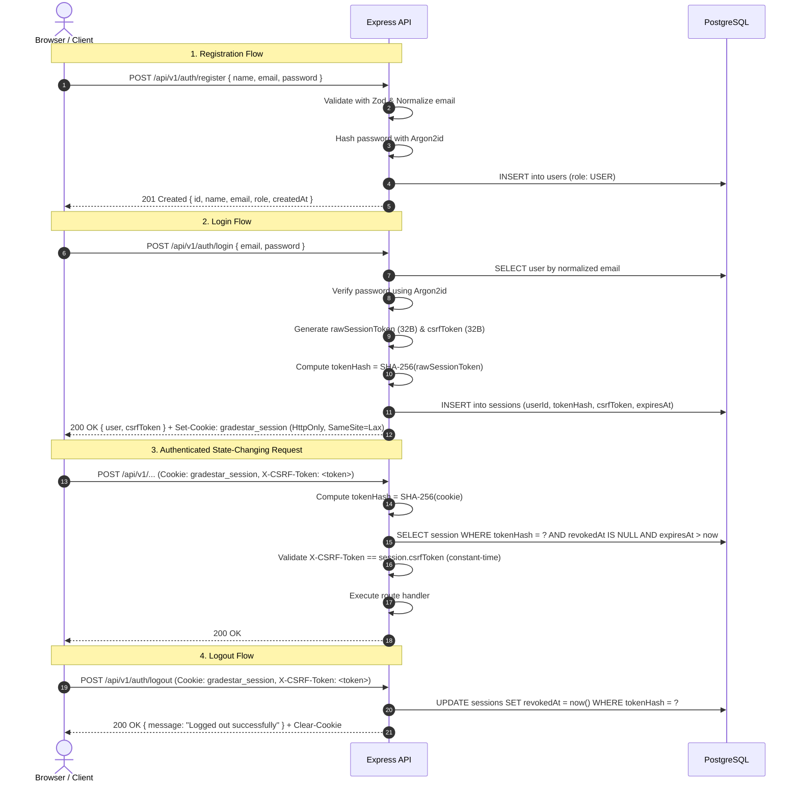

# GradeSTAR — Authentication & Authorization Specifications (Phase 3B)

## 1. Overview

GradeSTAR implements a secure, database-backed session authentication architecture with role-based access control (RBAC) and resource ownership enforcement.

- **Session Strategy**: Opaque, cryptographically random session tokens stored in the database exclusively as deterministic SHA-256 hashes (`tokenHash`). Delivered to browsers through secure HTTP-only cookies.
- **CSRF Defense**: Synchronizer Token Pattern using per-session cryptographic CSRF secrets (`csrfToken`) stored server-side and required in `X-CSRF-Token` headers for all unsafe/state-changing HTTP requests (`POST`, `PUT`, `PATCH`, `DELETE`).
- **Password Security**: Argon2id password hashing adhering to OWASP recommendations (64 MB memory cost, 3 iterations, 4 parallelism threads).
- **Authorization**:
  - Role-based permissions (`requireRole`): Server-enforced via PostgreSQL user records (`USER`, `ADMIN`).
  - Resource ownership (`requireOwnership` / `checkOwnership`): Guarantees users can only access their own resources unless granted an administrative override.
- **Abuse Prevention**: Rate limiting applied to `/register` and `/login` endpoints.

---

## 2. Authentication Flow



---

## 3. Endpoints Specification

| Method | Endpoint                | Authentication | CSRF | Description                               | Status Codes               |
| :----- | :---------------------- | :------------: | :--: | :---------------------------------------- | :------------------------- |
| `POST` | `/api/v1/auth/register` |      None      |  No  | Registers a new user with `USER` role     | `201`, `400`, `409`, `429` |
| `POST` | `/api/v1/auth/login`    |      None      |  No  | Verifies credentials, sets session cookie | `200`, `400`, `401`, `429` |
| `POST` | `/api/v1/auth/logout`   |    Session     | Yes  | Revokes session in DB, clears cookie      | `200`, `401`, `403`        |
| `GET`  | `/api/v1/auth/me`       |    Session     |  No  | Returns authenticated user profile        | `200`, `401`               |
| `GET`  | `/api/v1/auth/csrf`     |    Session     |  No  | Returns current session CSRF token        | `200`, `401`               |

---

## 4. Security Controls & Configurations

### Session Cookie Policy

- **Name**: `gradestar_session`
- **HttpOnly**: `true` (Prevents client-side script access, mitigating XSS session theft)
- **SameSite**: `Lax` (Protects against cross-site request forgery while permitting top-level navigations)
- **Path**: `/`
- **MaxAge**: 7 days (604,800,000 ms), matching server-side database expiration
- **Secure**: `true` in production over HTTPS; `false` in development

### CSRF Protection Policy

- Required on all state-changing methods (`POST`, `PUT`, `PATCH`, `DELETE`) for authenticated routes.
- Safe read-only methods (`GET`, `HEAD`, `OPTIONS`) and initial unauthenticated authentication requests (`/login`, `/register`) are exempt.
- Validated using `crypto.timingSafeEqual` to eliminate timing-attack vulnerabilities.

### Role & Ownership Authorization

- **Role Enforcement (`requireRole`)**: Verified directly against the database-backed user record (`req.user.role`). If a user's role is updated or revoked in PostgreSQL, subsequent requests immediately reflect the new permission state without waiting for a token to expire.
- **Ownership Verification (`requireOwnership` / `checkOwnership`)**: Verifies that `currentUserId === resourceOwnerId`. Administrative users (`ADMIN`) are granted access where `allowAdmin: true` is enabled.

---

## 5. Verification Commands

```bash
# Run authentication & authorization test suites
npm run test -w @gradestar/api -- tests/auth-register.test.ts tests/auth-login.test.ts tests/auth-session.test.ts tests/auth-csrf.test.ts tests/authorization-roles.test.ts tests/authorization-ownership.test.ts

# Run monorepo typecheck
npm run typecheck

# Run linter & prettier check
npm run lint && npm run format:check

# Run clean database verification
npm run db:verify-clean

# Run full monorepo test suite with coverage
npm run test:coverage
```
