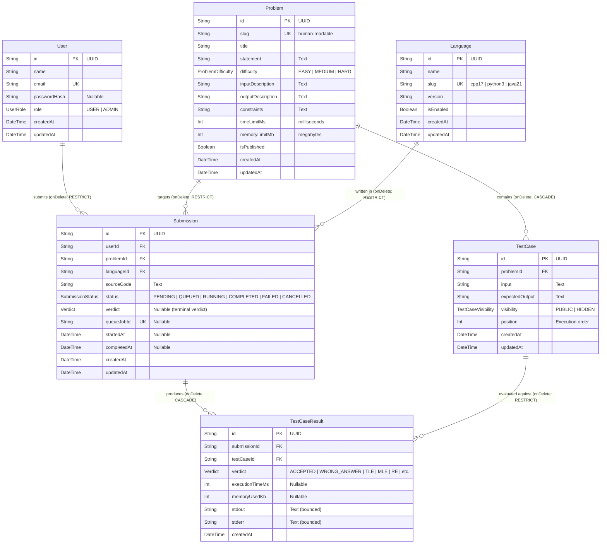

# GradeSTAR — Database Architecture & Relational Schema (Phase 2A)

## 1. Overview

GradeSTAR persists system state in PostgreSQL using Prisma ORM. The relational data model is designed to support:

- Users and role-based permissions (`User`)
- Programming challenges with sample and evaluation test cases (`Problem`, `TestCase`)
- Supported runtime languages (`Language`)
- Code submissions with lifecycle tracking and terminal verdicts (`Submission`)
- Granular per-test-case execution telemetry (`TestCaseResult`)

---

## 2. Entity-Relationship (ER) Diagram



---

## 3. Domain Enums

### UserRole

- `USER`: Standard student/user account.
- `ADMIN`: Authorized to create/modify problems and manage test cases.

### ProblemDifficulty

- `EASY`, `MEDIUM`, `HARD`: Categorization for problem browsing and filtering.

### TestCaseVisibility

- `PUBLIC`: Sample test cases displayed in problem statements.
- `HIDDEN`: Evaluation test cases used for grading; **never returned by public API queries**.

### SubmissionStatus vs. Verdict (Architectural Separation)

A major design principle in GradeSTAR is the clean separation of **Submission Lifecycle Status** from the **Evaluation Verdict**:

- **`SubmissionStatus`** tracks the execution state of the evaluation job:
  - `PENDING`: Persisted in DB, awaiting queue dispatch.
  - `QUEUED`: Enqueued into Redis/BullMQ.
  - `RUNNING`: Claimed by a worker daemon; container execution in progress.
  - `COMPLETED`: Worker finished evaluation successfully.
  - `FAILED`: Fatal infrastructure failure during grading (e.g. Docker daemon failure).
  - `CANCELLED`: Execution cancelled by user or administrator.

- **`Verdict`** records the code correctness evaluation result:
  - `ACCEPTED` (AC): All test cases passed within resource limits.
  - `WRONG_ANSWER` (WA): Code output did not match expected output.
  - `COMPILATION_ERROR` (CE): Compiler exited with non-zero status.
  - `RUNTIME_ERROR` (RE): Process crashed, threw unhandled exception, or non-zero exit code.
  - `TIME_LIMIT_EXCEEDED` (TLE): Execution exceeded CPU or wall-clock limits.
  - `MEMORY_LIMIT_EXCEEDED` (MLE): Process exceeded container memory limit.
  - `OUTPUT_LIMIT_EXCEEDED` (OLE): Process emitted stdout/stderr exceeding buffer bounds.
  - `SYSTEM_ERROR`: Internal grading failure.

> [!IMPORTANT]
> A submission in `PENDING`, `QUEUED`, or `RUNNING` status has `verdict: null`. The verdict is only written when grading concludes or when compilation fails.

---

## 4. Integrity Constraints & Foreign Key Policies

| Relationship                    | Constraint   | Policy                             | Rationale                                                                          |
| :------------------------------ | :----------- | :--------------------------------- | :--------------------------------------------------------------------------------- |
| `User` → `Submission`           | Foreign Key  | `ON DELETE RESTRICT`               | Preserves historical grading submissions if a user account is deleted or disabled. |
| `Problem` → `Submission`        | Foreign Key  | `ON DELETE RESTRICT`               | Prevents accidental loss of user submissions if a problem is removed.              |
| `Language` → `Submission`       | Foreign Key  | `ON DELETE RESTRICT`               | Prevents orphan submissions if a language runtime is deprecated.                   |
| `Problem` → `TestCase`          | Foreign Key  | `ON DELETE CASCADE`                | Deleting a problem safely cleans up all internal test cases.                       |
| `Submission` → `TestCaseResult` | Foreign Key  | `ON DELETE CASCADE`                | Test case results belong strictly to their parent submission.                      |
| `TestCase` → `TestCaseResult`   | Foreign Key  | `ON DELETE RESTRICT`               | Prevents test case deletion while historical grading records reference it.         |
| `Problem` + `position`          | Unique Index | `UNIQUE(problemId, position)`      | Enforces deterministic, collision-free test execution ordering.                    |
| `Submission` + `TestCase`       | Unique Index | `UNIQUE(submissionId, testCaseId)` | Guarantees exactly one result per test case per submission.                        |

---

## 5. Execution Metric Units

- **Time Limits & Durations**: Stored in **milliseconds (`Int`)**:
  - `Problem.timeLimitMs`: Maximum CPU/wall-clock execution allowed per test case.
  - `TestCaseResult.executionTimeMs`: Actual elapsed execution duration.
- **Memory Limits & Usage**:
  - `Problem.memoryLimitMb`: Configured container memory limit in **Megabytes (`Int`)**.
  - `TestCaseResult.memoryUsedKb`: Measured container/process memory consumption in **Kilobytes (`Int`)**.

---

## 6. Migration and Seeding Workflows

### Running Migrations

```bash
# Apply migrations locally
npm run db:migrate

# Inspect migration status against PostgreSQL
npm run db:status
```

### Seeding Development Data

GradeSTAR includes an idempotent seed script:

```bash
npm run db:seed
```

Seeded entities:

1. **Languages**:
   - `cpp17` (C++17)
   - `python3` (Python 3.11)
   - `java21` (Java 21)
2. **Problems**:
   - `two-sum` (Array processing, 4 test cases: 2 public, 2 hidden)
   - `palindrome-check` (String manipulation, 4 test cases: 2 public, 2 hidden)
   - `fibonacci-number` (Recursion/DP, 4 test cases: 2 public, 2 hidden)
