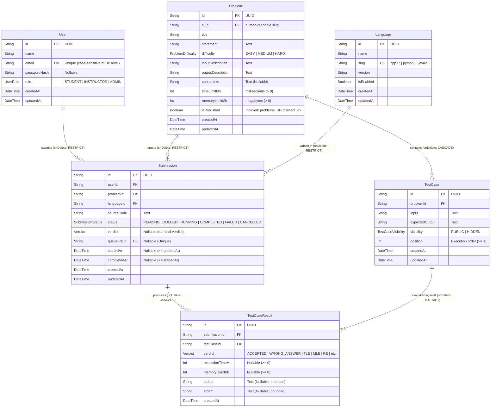

# GradeSTAR — Database Architecture & Relational Schema

## 1. Overview

GradeSTAR persists system state in PostgreSQL using Prisma ORM. The relational data model is designed to support:

- Users and role-based permissions (`User`)
- Programming challenges with sample and evaluation test cases (`Problem`, `TestCase`)
- Supported runtime languages (`Language`)
- Code submissions with lifecycle tracking and terminal verdicts (`Submission`)
- Granular per-test-case execution telemetry (`TestCaseResult`)

---

## 2. Entity-Relationship (ER) Diagram



---

## 3. Domain Enums

### UserRole

- `STUDENT`: Standard candidate/student account.
- `INSTRUCTOR`: Course instructor authorized to create challenges and inspect aggregated performance.
- `ADMIN`: Platform administrator with full access to manage problems, languages, and system settings.

### ProblemDifficulty

- `EASY`, `MEDIUM`, `HARD`: Categorization for problem browsing and filtering.

### TestCaseVisibility

- `PUBLIC`: Sample test cases displayed in problem statements.
- `HIDDEN`: Evaluation test cases used for grading; **never returned by public API queries**.

### SubmissionStatus vs. Verdict (Architectural Separation)

A major design principle in GradeSTAR is the clean separation of **Submission Lifecycle Status** from the **Evaluation Verdict**:

- **`SubmissionStatus`** tracks the operational pipeline state of the evaluation job:
  - `PENDING`: Persisted in DB, awaiting queue dispatch.
  - `QUEUED`: Enqueued into Redis/BullMQ.
  - `RUNNING`: Claimed by an execution worker; container execution in progress.
  - `COMPLETED`: Worker finished evaluation successfully.
  - `FAILED`: Fatal infrastructure failure during grading (e.g. Docker daemon failure).
  - `CANCELLED`: Execution cancelled by user or administrator.

- **`Verdict`** records the code correctness evaluation result:
  - `ACCEPTED` (AC): All test cases passed within resource limits.
  - `WRONG_ANSWER` (WA): Code output did not match expected output.
  - `COMPILATION_ERROR` (CE): Compiler exited with non-zero status.
  - `RUNTIME_ERROR` (RE): Process crashed, threw unhandled exception, or non-zero exit code.
  - `TIME_LIMIT_EXCEEDED` (TLE): Execution exceeded CPU or wall-clock limits.
  - `MEMORY_LIMIT_EXCEEDED` (MLE): Process exceeded container memory limit.
  - `OUTPUT_LIMIT_EXCEEDED` (OLE): Process emitted stdout/stderr exceeding buffer bounds.
  - `SYSTEM_ERROR`: Internal grading infrastructure failure.

> [!IMPORTANT]
> The database enforces that `PENDING`, `QUEUED`, and `RUNNING` submissions **must have `verdict: null`**. A submission in `COMPLETED` status **must have a non-null verdict**. `FAILED` submissions may have `verdict = SYSTEM_ERROR` or `null`. `CANCELLED` submissions must have `verdict: null`.

---

## 4. Integrity Constraints & Foreign Key Policies

| Relationship                    | Constraint   | Policy                             | Rationale                                                                          |
| :------------------------------ | :----------- | :--------------------------------- | :--------------------------------------------------------------------------------- |
| `User` → `Submission`           | Foreign Key  | `ON DELETE RESTRICT`               | Preserves historical grading submissions if a user account is deleted or disabled. |
| `Problem` → `Submission`        | Foreign Key  | `ON DELETE RESTRICT`               | Prevents accidental loss of user submissions if a problem is removed.              |
| `Language` → `Submission`       | Foreign Key  | `ON DELETE RESTRICT`               | Prevents orphan submissions if a language runtime is deprecated.                   |
| `Problem` → `TestCase`          | Foreign Key  | `ON DELETE CASCADE`                | Deleting a problem safely cleans up all internal test cases.                       |
| `Submission` → `TestCaseResult` | Foreign Key  | `ON DELETE CASCADE`                | Test case results belong strictly to their parent submission.                      |
| `TestCase` → `TestCaseResult`   | Foreign Key  | `ON DELETE RESTRICT`               | Prevents test case deletion while historical grading records reference it.         |
| `Problem` + `position`          | Unique Index | `UNIQUE(problemId, position)`      | Enforces deterministic, collision-free test execution ordering.                    |
| `Submission` + `TestCase`       | Unique Index | `UNIQUE(submissionId, testCaseId)` | Guarantees exactly one result per test case per submission.                        |
| `Submission` + `queueJobId`     | Unique Index | `UNIQUE(queueJobId)`               | Prevents duplicate worker scheduling for identical queue job identifiers.          |
| `Problem.isPublished`           | B-tree Index | `INDEX(isPublished)`               | Accelerates catalog queries filtering for public problems.                         |

---

## 5. PostgreSQL Database CHECK Constraints

Applied via reviewed migration `20261113182853_add_integrity_check_constraints`:

1. `problems_timeLimitMs_positive_check`: `CHECK ("timeLimitMs" > 0)`
2. `problems_memoryLimitMb_positive_check`: `CHECK ("memoryLimitMb" > 0)`
3. `test_cases_position_positive_check`: `CHECK ("position" >= 1)`
4. `submissions_completedAt_after_startedAt_check`: `CHECK ("completedAt" IS NULL OR "startedAt" IS NULL OR "completedAt" >= "startedAt")`
5. `submissions_startedAt_after_createdAt_check`: `CHECK ("startedAt" IS NULL OR "startedAt" >= "createdAt")`
6. `submissions_status_verdict_check`:
   ```sql
   CHECK (
     ("status" IN ('PENDING', 'QUEUED', 'RUNNING') AND "verdict" IS NULL) OR
     ("status" = 'COMPLETED' AND "verdict" IS NOT NULL) OR
     ("status" = 'FAILED' AND ("verdict" IS NULL OR "verdict" = 'SYSTEM_ERROR')) OR
     ("status" = 'CANCELLED' AND "verdict" IS NULL)
   )
   ```
7. `test_case_results_executionTimeMs_non_negative_check`: `CHECK ("executionTimeMs" IS NULL OR "executionTimeMs" >= 0)`
8. `test_case_results_memoryUsedKb_non_negative_check`: `CHECK ("memoryUsedKb" IS NULL OR "memoryUsedKb" >= 0)`

---

## 6. Seed Data Reference & Hardening

GradeSTAR includes an atomic, idempotent database seed script (`packages/database/src/seed.ts`):

```bash
npm run db:seed
```

### 6.1 Managed Seed Records

1. **Languages**:
   - `cpp17` (C++17, version: '17', isEnabled: true)
   - `python3` (Python 3, version: '3.11', isEnabled: true)
   - `java21` (Java 21, version: '21', isEnabled: true)
2. **Problems & Test Cases**:
   - `two-sum` (Array processing; 4 test cases: 2 public, 2 hidden)
   - `palindrome-check` (String manipulation; 4 test cases: 2 public, 2 hidden)
   - `fibonacci-number` (Recursion/DP; 4 test cases: 2 public, 2 hidden)

### 6.2 Idempotency & Preservation Policy

- **Transaction Wrapped**: The entire seed runs within an interactive Prisma transaction. Partial failure automatically rolls back all changes.
- **Upsert Strategy**: Seeded records are matched by unique slugs (`Language.slug`, `Problem.slug`) and `(problemId, position)` for test cases.
- **Preservation Guarantee**: Re-running the seed updates managed problems and languages but **never deletes** unrelated problems, user accounts, submissions, or evaluation telemetry.

---

## 7. Reusable Relational Query Helpers

The database package provides query helpers in `packages/database/src/queries.ts`:

- `getPublishedProblemBySlug(client, slug, { includePublicTestCases?: boolean })`: Retrieves published problem, optionally joining public test cases. Returns `null` if unpublished.
- `getPublicTestCases(client, problemId)`: Retrieves **only** public test cases (`visibility: PUBLIC`), ordered by `position ASC`. Strictly excludes hidden test cases.
- `getEvaluationTestCases(client, problemId)`: Retrieves **all** test cases (public + hidden) ordered by `position ASC` for trusted worker/evaluator engines.
- `getEnabledLanguages(client)`: Returns active languages (`isEnabled: true`).
- `getUserSubmissions(client, userId, options?)`: Returns submissions ordered newest first (`createdAt DESC`).
- `getSubmissionWithDetails(client, submissionId)`: Deeply joins submission with user, problem, language, and test case results.

---

## 8. Known Limitations

1. **Hidden Test-Case API Confidentiality**: While `getPublicTestCases()` filters hidden cases at the database query level, API authorization, rate limiting, and response payload shaping must be enforced at the HTTP gateway layer in later phases.
2. **Email Case Normalization**: PostgreSQL's unique constraint on `users.email` is binary/exact-match by default. Normalization to lowercase must remain strictly enforced at the application boundary (e.g., Zod schemas and service logic).
3. **Test Case Versioning**: Test cases currently belong directly to problems. In future phases, problem versioning will snapshot test cases so historical submissions reference immutable problem revisions.
