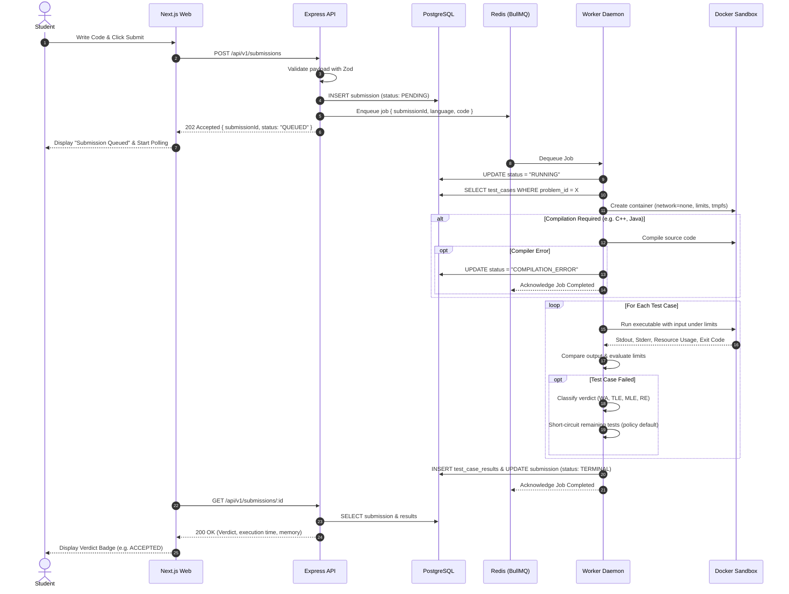

# GradeSTAR — Architecture & System Design Overview

## 1. Executive Summary

**GradeSTAR** is a distributed, asynchronous automated programming assignment grader designed to evaluate untrusted student source code (C++17, Python 3, Java 21) securely, reliably, and deterministically.

Unlike monolithic online judges that compile and run code inside the API server process, GradeSTAR separates untrusted code execution from user-facing services. Evaluation requests are persisted, enqueued into durable Redis queues (via BullMQ), and processed concurrently by isolated worker daemons that orchestrate hardened Docker execution containers.

---

## 2. High-Level Architecture Diagram

```mermaid
flowchart TD
    subgraph Client ["Client Layer"]
        User["User / Student Browser"]
    end

    subgraph Frontend ["Web Application (Next.js App Router)"]
        WebUI["Web UI\n(Problem Catalogue, Editor, Polling Results)"]
    end

    subgraph TrustedServices ["Trusted Infrastructure Services"]
        API["Express REST API (/api/v1)\n(Auth, Zod Validation, Dual-Write Dispatch)"]
        PG[("PostgreSQL\n(Users, Problems, Submissions, Verdicts)")]
        Redis[("Redis & BullMQ\n(Job Queues, Concurrency, Retries)")]
        Workers["Distributed Worker Daemons\n(Job Claiming, Execution Orchestrator)"]
    end

    subgraph UntrustedBoundary ["Untrusted Code Execution Sandbox (Planned: Phase 5)"]
        DockerHost["Docker Daemon"]
        subgraph Containers ["Ephemeral Hardened Execution Containers"]
            direction TB
            Sandbox["Container Sandbox\n- Network: none\n- Read-only Rootfs\n- CPU/Memory/PIDs Limits\n- Dropped Linux Capabilities\n- Non-root User\n- Parent Wall-Clock Timeout"]
        end
    end

    User -->|Submits Source Code| WebUI
    WebUI -->|POST /api/v1/submissions| API
    WebUI -.->|Polls Status /results| API

    API -->|1. Persist Submission PENDING| PG
    API -->|2. Enqueue Evaluation Job| Redis

    Redis -->|3. Claim Job| Workers
    Workers -->|4. Fetch TestCases| PG
    Workers -->|5. Create Isolated Container| DockerHost
    DockerHost -->|Spawn| Sandbox
    Sandbox -->|Execute & Enforce Limits| Sandbox
    Sandbox -->|Return Output, Time, Memory| Workers
    Workers -->|6. Classify Verdict (AC, WA, TLE, MLE)| Workers
    Workers -->|7. Persist Terminal Verdict| PG
    API -->|8. Return Final Verdict & Metrics| WebUI
```

> **Legend:**
>
> - Solid lines represent active synchronous requests / database interactions.
> - Dashed lines represent asynchronous polling / background job dispatch.
> - **Note on Implementation Status**: The Web UI, API skeleton, Worker daemon skeleton, and Monorepo are scaffolded in **Phase 1**. PostgreSQL schema, BullMQ queue integration, and Docker sandbox execution are **planned for subsequent phases**.

---

## 3. Monorepo Structure and Responsibilities

The codebase is organized as an npm-workspaces monorepo:

```
gradestar/
├── apps/
│   ├── web/                    # Next.js App Router frontend (Portfolio & Workspace)
│   ├── api/                    # Express REST API (/api/v1)
│   └── worker/                 # Distributed worker daemon service
├── packages/
│   ├── shared/                 # Common interfaces, enums (Verdicts), and DTOs
│   ├── logging/                # Reusable structured Pino logging with dev pretty-print
│   ├── database/               # [Planned: Phase 2] Prisma schema & PostgreSQL client
│   ├── evaluator/              # [Planned: Phase 5] Output normalizer & verdict classifier
│   ├── execution/              # [Planned: Phase 5] Docker container isolation adapter
│   ├── language-config/        # [Planned: Phase 5] Compiler flags & runtime configs (C++, Python, Java)
│   └── testing/                # Shared test fixtures and environment mocking utilities
├── infrastructure/
│   ├── docker/                 # Containerfiles for language execution runtimes
│   ├── scripts/                # Development, seeding, and migration automation
│   └── monitoring/             # Health metrics, Prometheus/Grafana configs
├── tests/
│   ├── integration/            # End-to-end multi-service tests
│   ├── e2e/                    # Playwright browser automation
│   ├── security/               # Sandboxed malicious payload stress tests
│   └── load/                   # k6 concurrent load testing scripts
└── docs/
    └── architecture/           # System design and operational documentation
```

### Component Breakdown

| Component                      | Responsibility                                                                                                                       | Current Status                           |
| :----------------------------- | :----------------------------------------------------------------------------------------------------------------------------------- | :--------------------------------------- |
| **`apps/web`**                 | User interface, problem catalog, Monaco code editor, submission polling, and verdict telemetry display.                              | Scaffolded (Phase 1 Preview)             |
| **`apps/api`**                 | REST endpoints (`/health`, `/ready`, `/submissions`), request validation, authentication, submission creation, and queue publishing. | Functional (`/health`, `/ready`, errors) |
| **`apps/worker`**              | Independent daemon processing evaluation jobs from BullMQ, pulling test cases, running containers, and storing verdicts.             | Scaffolded (Lifecycle management)        |
| **`packages/shared`**          | Contract types: `HealthResponse`, `ReadyResponse`, `ApiErrorResponse`, `SubmissionVerdict`.                                          | Functional                               |
| **`packages/logging`**         | Structured JSON logging in production; formatted colored output in local development.                                                | Functional                               |
| **`packages/database`**        | Prisma ORM client, relational schema, migrations, connection lifecycle.                                                              | Planned (Phase 2)                        |
| **`packages/evaluator`**       | Output diffing, trailing whitespace normalization, and verdict classification.                                                       | Planned (Phase 5)                        |
| **`packages/execution`**       | Docker container runtime lifecycle, resource limits, and timeout enforcement.                                                        | Planned (Phase 5)                        |
| **`packages/language-config`** | Explicit definitions for C++17, Python 3, and Java 21 compilation & execution.                                                       | Planned (Phase 5)                        |

---

## 4. Asynchronous Submission Workflow (Planned: Phase 3–5)



---

## 5. Security & Isolation Boundary

Untrusted code execution presents significant security risks. GradeSTAR enforces multi-layered defense-in-depth:

1. **Strict Container Sandboxing**:
   - `--network none`: Untrusted code cannot perform network I/O, connect to external servers, or scan local network segments.
   - Non-root execution: Processes run as an unprivileged user inside the container.
   - Dropped Linux Capabilities: `ALL` capabilities dropped; `no-new-privileges` enforced.
   - Read-only root filesystem: Code cannot modify container OS files.
   - Memory and Swap limits: Capped memory with `--memory-swap` equal to `--memory` to prevent swap-thrashing.
   - Process limits (`--pids-limit 64`): Mitigates fork bombs.
   - Parent Wall-Clock Timeout: Node.js worker forcefully destroys containers that exceed timeout limits even if the process ignores `SIGTERM`.
2. **Confidentiality of Hidden Test Cases**:
   - Test cases marked `HIDDEN` are never returned in public API payloads.
   - Evaluator runs securely within the backend worker; expected outputs are never exposed to the client browser.
3. **Dual-Write Reliability**:
   - Writing to PostgreSQL and Redis is not an atomic operation. GradeSTAR plans an outbox pattern / reconciliation sweep to guarantee no submission remains indefinitely in `PENDING`.
